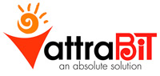

<h1 align="center">Hi👋, I'm Shohag</h1>
<h3 align="center">Ex-SELISE & DataSoft | .NET(C#) | MSSQL | Solidity | Web3 | Ethereum & Polygon | ERC Standard | IPFS | ETL | Clean Code | Continuous Learner</h3>

#### Who I am?
- A Senior Software Engineer based in **[Dhaka](https://en.wikipedia.org/wiki/Dhaka), [Bangladesh](https://en.wikipedia.org/wiki/Bangladesh)** 
- Having 9 years of hands-on experience in **New Technology Adoption, End-To-End Product Design & Development** with **SDLC**
- Developed products for **Financial Service(Remittance, Anti-Money Laundering-AML),HealthCare, Retail & Logistics** business domains
- Having built **Web** apps targeting **Multi-Platform**, **Cross-Platform** ecosystems in **Monolithic**, **Microservices** and **Hybrid** architectures
- Check out my documents- <a href="https://1drv.ms/f/c/4c566a07c085f217/EhfyhcAHalYggExqAAAAAAABtxp3mnSllgJIU1hOHW2QKQ?e=hh7waA" target="_blank">📄Download Updated CV</a> | <a href="https://www.hackerrank.com/eshohag" target="_blank">HackerRank Profile</a> | <a href="https://www.nuget.org/profiles/eshohag" target="_blank">Contribution Nuget Packages</a> | <a href="https://shohag.azurewebsites.net/" target="_blank">Personal Website</a> 📫eshohag@outlook.com

#### What I'm doing?
- 🏢 Working at **[BRAC IT Services Ltd](https://www.bracits.com/)** as a **Senior Software Engineer**
- 🪜 Previously worked at **[SELISE Digital Platforms](http://selise.ch/)** | **[Datasoft Systems Bangladesh Ltd](http://datasoft-bd.com/)** | **[attraBiT Technologies](http://www.attrabit.com/)** as a Software Engineer
- 👨‍💻 Writing `C#` `SQL` `Solidity` `JavaScript`
- 🌱 Currently learning about **EVM base Blockchain[Smart Contract], NFT Development**, **Clean Architecture**, **Large Scale System Design**
- 👯 Looking to collaborate on **Blockchain & .NET projects**
- 🥰 Building various [repositories](https://github.com/eshohag?tab=repositories/) as pet projects
#### What I like to disscuss about? 
- 💬 Ask me about `microsoft stack` `web APIs` `system design` `scalability` `design patterns` `data structures` `coding speed hacks` `clean code` `requirement analysis` `sdlc` `choice of frameworks` and `tech culture`

#### What my skill set looks like?
- 🖥 **Front-End:** 
  - **📜 Languages:** • `HTML` • `CSS` • `XAML` • `JavaScript` • `jQuery` • `ajax` • `json` • `angularJs` • `reactJs` • `web3js`
  - **🔬 Frameworks:**  
    - **🖥 Desktop:** • [Windows Forms](https://learn.microsoft.com/en-us/dotnet/desktop/winforms/get-started/create-app-visual-studio/) • [WPF](https://docs.microsoft.com/en-us/dotnet/desktop/wpf/overview/) 
    - **🌐 Web:** • [ASP.NET MVC](https://dotnet.microsoft.com/en-us/apps/aspnet/mvc) • [web3js](https://web3js.readthedocs.io/)
  - **📋 Reporting toolkits:** • [RDLC](https://docs.fileformat.com/reporting/rdlc/#:~:text=(.rdlc)%20Files-,What%20is%20an%20RDLC%20file%3F,used%20to%20create%20these%20files.) • [Crystal Reports](https://www.sap.com/products/technology-platform/crystal-reports.html)
- 🗄️ **Back-End:**
  - **📜 Languages:** • `🧙🏻‍♂️ C#` `SQL` `Solidity`
  - **🔭 Services:** • [ASP.NET Web API](https://dotnet.microsoft.com/en-us/apps/aspnet/apis) • [Windows Service](https://learn.microsoft.com/en-us/dotnet/framework/windows-services/introduction-to-windows-service-applications) • [WCF](https://learn.microsoft.com/en-us/dotnet/framework/wcf/whats-wcf)
  - **🕹 Frameworks:** •[.NET 8](https://dotnet.microsoft.com/en-us/download/dotnet/8.0) •[.NET 7](https://dotnet.microsoft.com/en-us/download/dotnet/7.0) •[.NET 6](https://dotnet.microsoft.com/en-us/download/dotnet/6.0) •[.NET 5](https://dotnet.microsoft.com/en-us/download/dotnet/5.0) •[.NET Core 3.1](https://dotnet.microsoft.com/en-us/download/dotnet/3.1) •[.NET Standard 2.0](https://docs.microsoft.com/en-us/dotnet/standard/net-standard?tabs=net-standard-1-0) •[.NET Framework 4.8](https://dotnet.microsoft.com/en-us/download/dotnet-framework/net48) •[Entity Framework](https://docs.microsoft.com/en-us/ef/)
  - **💾 Databases:** • [SQL Server](https://www.microsoft.com/en-us/sql-server/sql-server-2019) • [MongoDB](https://www.mongodb.com/)
  - **🎛 System architecture:** • [Monolithic](https://microservices.io/patterns/monolithic.html) • [Microservices](https://microservices.io/patterns/microservices.html)
  - **🔌 Communication protocols:** • [REST](https://docs.microsoft.com/en-us/azure/architecture/best-practices/api-design) • [SignalR](https://dotnet.microsoft.com/en-us/apps/aspnet/signalr)
- 🎡 **Software development ecosystem:**
  - **📁 Code Repository:** • [Git](https://git-scm.com/) • [BitBucket](https://bitbucket.org/product) • [Azure DevOps Server](https://azure.microsoft.com/en-us/services/devops/server/)
  - **🗃 Project management:** • [Jira Scrum Boards](https://www.atlassian.com/software/jira/features/scrum-boards) • [Azure Boards](https://azure.microsoft.com/en-us/services/devops/boards/)
  - **🚀 CI/CD:** • [IIS](https://www.iis.net/) • [Azure Pipelines](https://azure.microsoft.com/en-us/services/devops/pipelines/) • [Github Actions](https://github.com/features/actions) • [Github Pages](https://pages.github.com/)
- 🧙‍♂️ **Coding pattern & principles:**
  - **⚒ Patterns:**  • [Repository](https://learn.microsoft.com/en-us/aspnet/mvc/overview/older-versions/getting-started-with-ef-5-using-mvc-4/implementing-the-repository-and-unit-of-work-patterns-in-an-asp-net-mvc-application) • [Unit of Work](https://learn.microsoft.com/en-us/aspnet/mvc/overview/older-versions/getting-started-with-ef-5-using-mvc-4/implementing-the-repository-and-unit-of-work-patterns-in-an-asp-net-mvc-application) • [MVVM](https://en.wikipedia.org/wiki/Model%E2%80%93view%E2%80%93viewmodel) • [MVC](https://en.wikipedia.org/wiki/Model%E2%80%93view%E2%80%93controller) 
  - **🗜 Principles:** • [DRY](https://en.wikipedia.org/wiki/Don%27t_repeat_yourself#:~:text=%22Don%27t%20repeat%20yourself%22,data%20normalization%20to%20avoid%20redundancy.) • [DDD](https://en.wikipedia.org/wiki/Domain-driven_design) • [SOLID](https://www.digitalocean.com/community/conceptual_articles/s-o-l-i-d-the-first-five-principles-of-object-oriented-design)
  
- **🏗️ Code editors:**
 

#### What's interesting about me?  
  - 🧐 I love to be very **precise** and **thorough**, I hate **procrastinating**
  - ✍️ I write about **why a certain code is written instead of what** in the comments
  - ⏱️ I'm a **workaholic** and drink a lot of ☕ **coffee**
  - 😅 I just can't **resist the urge** to **explore** a new **tech** released in the **.NET** ecosystem
<!--Github Stats-->

 

#### What companies have I worked for?

 

   
  
  
  
  

 
<h5 align="center"></h5>
